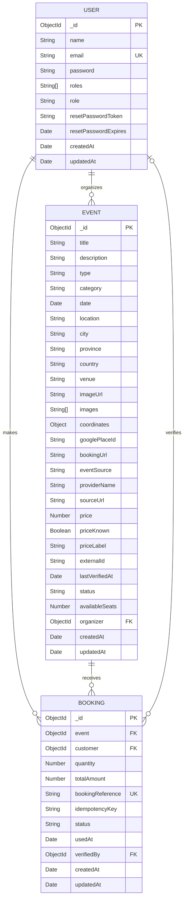

# EventEase — Entity Relationship Diagram

This diagram represents the three primary Mongoose models found in the EventEase backend: User, Event and Booking.

## Entity Relationship Diagram

## Relationship Explanation

| Relationship | Description |
|---|---|
| User → Event | A user can organize multiple EventEase events. |
| User → Booking | A customer can create multiple bookings. |
| Event → Booking | An event can receive multiple bookings. |
| User → Booking verification | A user can verify multiple bookings; each booking can have an optional verifier. |

## Diagram Notes

- PK means Primary Key.
- FK means Foreign Key reference through MongoDB ObjectId.
- UK means unique field or unique index.
- The diagram represents logical relationships, not relational database tables.
- Coordinates are embedded in the Event document.
- The organizer reference is conditionally required for EventEase-created events.
- The verifier reference is optional.
- MongoDB references are not SQL foreign-key constraints.
