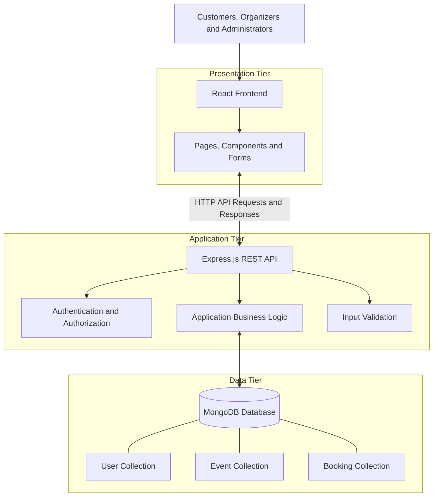
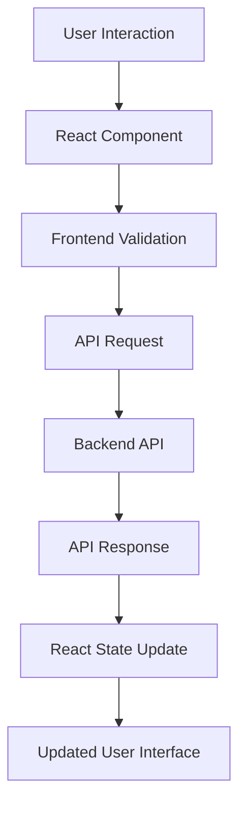
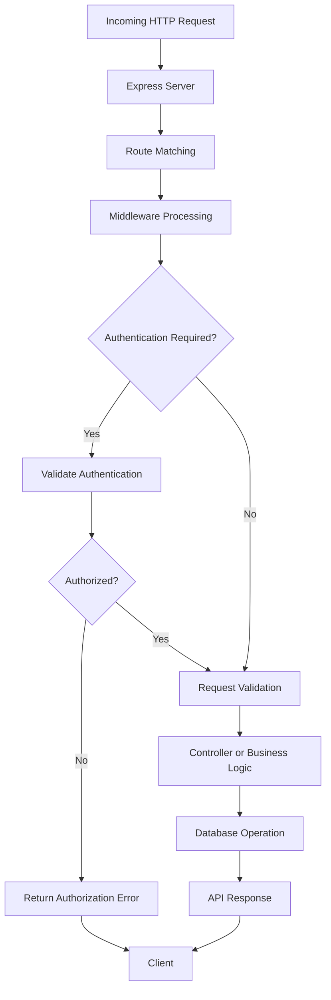
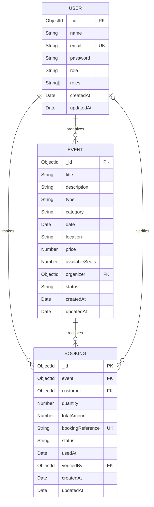
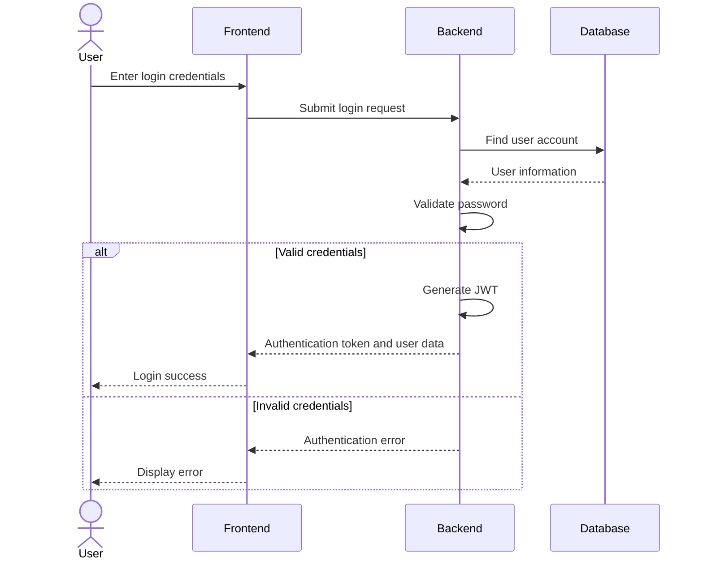
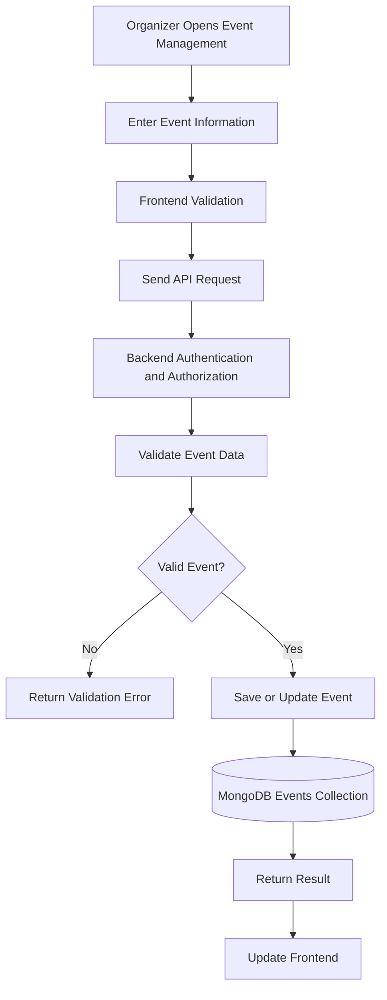
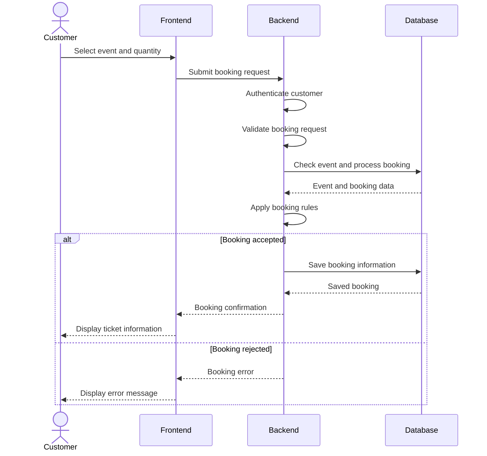
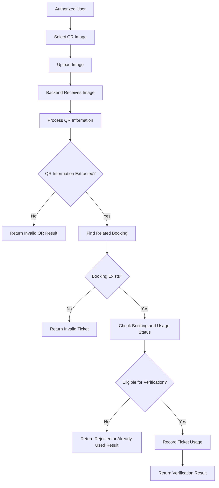
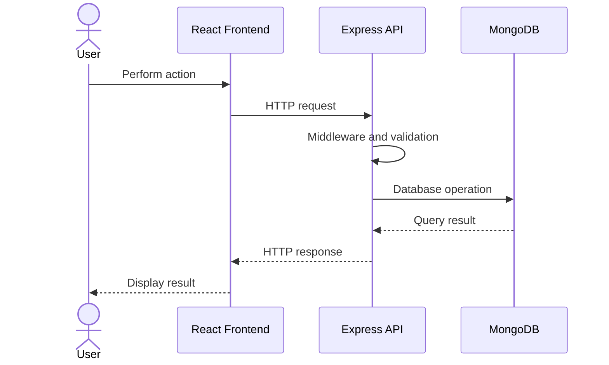
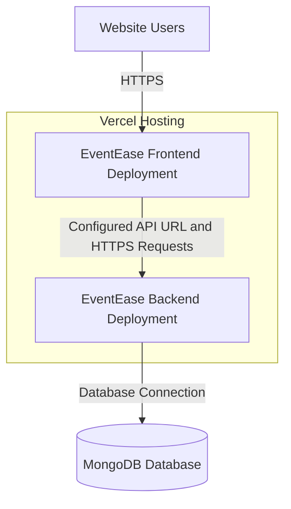

# EventEase
## System Architecture Documentation

**Project Name:** EventEase – Event Management and Ticketing System
**Document Type:** System Architecture Documentation
**Version:** 1.0
**Project Scope:** Pakistan
**Architecture Style:** Three-Tier Client-Server Architecture
**Frontend:** React
**Backend:** Node.js and Express.js
**Database:** MongoDB with Mongoose
**Authentication:** JWT-based authentication
**Deployment:** Vercel

---

# 1. Introduction

## 1.1 Purpose

This document describes the system architecture of EventEase, a web-based event management and ticketing application.

It explains the overall architecture, software components, communication between system layers, database structure, authentication process, event management, ticket booking, QR-based ticket verification and deployment architecture.

The document serves as a technical reference for developers, testers, maintainers and academic evaluators.

## 1.2 System Overview

EventEase is a full-stack web application designed to provide a centralized platform for event discovery, event management and ticket booking in Pakistan.

The application allows customers to discover events and book tickets. Organizers can manage their events, while administrators have access to administrative functionality.

The system uses a React-based frontend, a Node.js and Express.js backend, and MongoDB for persistent data storage.

The frontend communicates with the backend through API requests. The backend handles business logic, authentication, validation and database operations.

## 1.3 Architectural Objectives

The architecture is designed to:

1. Separate the frontend, backend and database responsibilities.
2. Provide a maintainable and modular application structure.
3. Support authentication and role-based authorization.
4. Maintain consistent event and booking information.
5. Support digital ticket and QR image verification workflows.
6. Provide a responsive user experience.
7. Support independent frontend and backend deployment.
8. Allow future improvements without redesigning the entire application.

---

# 2. Overall System Architecture

## 2.1 Architecture Style

EventEase follows a three-tier client-server architecture.

The three primary tiers are:

1. **Presentation Tier:** React frontend responsible for the user interface and user interactions.
2. **Application Tier:** Node.js and Express.js backend responsible for API handling, business logic, authentication and validation.
3. **Data Tier:** MongoDB database responsible for storing users, events and bookings.

This separation makes the application easier to maintain, test and extend.

## 2.2 High-Level Architecture Diagram

## 2.3 Architecture Description

### Presentation Tier

The presentation tier is implemented using React.

Its responsibilities include:

- Displaying the application interface.
- Showing available events.
- Collecting user input.
- Providing registration and login forms.
- Displaying event details.
- Supporting event search and filtering.
- Providing booking interfaces.
- Displaying booking and ticket information.
- Providing role-appropriate dashboards.
- Supporting QR image upload.

The frontend sends requests to the backend and displays the returned results.

### Application Tier

The application tier is implemented using Node.js and Express.js.

Its responsibilities include:

- Receiving API requests.
- Processing user authentication.
- Enforcing authorization rules.
- Validating incoming data.
- Executing event management operations.
- Processing booking requests.
- Handling ticket verification requests.
- Communicating with MongoDB.
- Returning appropriate API responses.

### Data Tier

The data tier uses MongoDB with Mongoose.

Its responsibilities include:

- Storing user account information.
- Storing event information.
- Storing booking and ticket-related information.
- Maintaining references between related records.
- Applying schema validation.
- Supporting indexed database queries.

---

# 3. Frontend Architecture

## 3.1 Technology

The frontend is developed using React and JavaScript.

The frontend is responsible for presenting application functionality to users through a browser-based interface.

## 3.2 Frontend Responsibilities

The frontend provides:

- Authentication interfaces.
- Event discovery and listing.
- Search and filtering.
- Event details.
- Event management interfaces.
- Ticket booking interfaces.
- Booking information.
- Digital ticket presentation.
- QR image upload interface.
- Dashboard interfaces.
- Responsive layouts.

## 3.3 Frontend Communication

The frontend communicates with the backend through API requests.

The API base URL is configured through the frontend environment variable:

`VITE_API_URL`

The frontend API configuration also supports a local development fallback.

The production frontend uses the configured backend API URL.

## 3.4 Frontend Request Flow

## 3.5 Frontend Design Considerations

- Components should have clear responsibilities.
- User input should be validated before submission where appropriate.
- API responses should be handled appropriately.
- Loading and error states should provide feedback.
- Protected functionality should be presented according to user permissions.
- Responsive layouts should support different screen sizes.

Frontend visibility alone is not a security boundary; protected operations must also be authorized by the backend.

---

# 4. Backend Architecture

## 4.1 Technology

The backend is developed using:

- Node.js
- Express.js
- JavaScript
- Mongoose
- JSON Web Tokens (JWT)
- Environment-based configuration

## 4.2 Backend Responsibilities

The backend is responsible for:

1. Exposing API endpoints.
2. Processing authentication requests.
3. Validating user permissions.
4. Handling event operations.
5. Processing booking requests.
6. Maintaining booking status.
7. Processing QR image verification.
8. Performing database operations.
9. Handling errors.
10. Returning API responses.

## 4.3 Backend Request Processing

A typical backend request follows this sequence:

The exact middleware and controller sequence depends on the individual API route.

## 4.4 Backend Configuration

The backend uses environment variables for configuration.

Relevant configuration names identified in the project include:

| Variable | Purpose |
|---|---|
| `PORT` | Backend server port |
| `MONGODB_URI` | MongoDB connection configuration |
| `JWT_SECRET` | JWT signing and verification secret |
| `CORS_ORIGIN` | Allowed frontend origins |
| `FRONTEND_URL` | Frontend URL configuration |
| `CLOUDINARY_CLOUD_NAME` | Cloudinary cloud configuration |
| `CLOUDINARY_API_KEY` | Cloudinary API configuration |
| `CLOUDINARY_API_SECRET` | Cloudinary secret configuration |
| `SMTP_HOST` | Email server host |
| `SMTP_PORT` | Email server port |
| `SMTP_USER` | Email server username |
| `SMTP_PASS` | Email server password |
| `EMAIL_FROM` | Configured sender identity |

Actual secret values must remain private and must never be included in public documentation.

---

# 5. Database Architecture

## 5.1 Database Technology

EventEase uses MongoDB as its primary database.

Mongoose provides schema definitions, validation, model functionality and database interaction.

## 5.2 Main Database Collections

The inspected backend model directory contains three primary models.

### User Model

The User model stores:

- User name.
- Email address.
- Password information.
- User role information.
- Password-reset-related information.
- Creation and update timestamps.

The model supports customer, organizer and administrator role values.

It also contains both a legacy `role` field and a `roles` array for role-related compatibility.

### Event Model

The Event model stores:

- Event title.
- Description.
- Event type.
- Category.
- Date.
- Location.
- City.
- Province.
- Country.
- Venue.
- Event images.
- Coordinates.
- Price information.
- Available seats.
- Organizer reference.
- Event status.
- Event source information.
- Creation and update timestamps.

The model supports both EventEase-managed and external event-source records.

### Booking Model

The Booking model stores:

- Event reference.
- Customer reference.
- Ticket quantity.
- Total amount.
- Unique booking reference.
- Idempotency key.
- Booking status.
- Ticket usage timestamp.
- Verifying user reference.
- Creation and update timestamps.

The Booking model also contains indexes intended to support common customer, event and status queries.

## 5.3 Database Relationship Diagram

The diagram represents logical references between MongoDB documents. These ObjectId references are not SQL foreign-key constraints.

## 5.4 Database Design Principles

The database design follows these principles:

- Separate user, event and booking records.
- Use ObjectId references to associate related records.
- Apply schema-level validation.
- Use unique constraints where required.
- Use indexes to support common queries.
- Maintain timestamps for relevant records.
- Keep booking and ticket usage information associated with booking records.

For complete field definitions and declared indexes, refer to:

- `DATABASE_DOCUMENTATION.md`
- `ER_DIAGRAM.md`

---

# 6. Authentication and Authorization Architecture

## 6.1 Authentication

EventEase uses JWT-based authentication.

Authentication allows the backend to identify users making protected requests.

The general authentication process is:

1. A user enters login credentials.
2. The frontend sends the credentials to the backend.
3. The backend validates the credentials.
4. If the credentials are valid, the backend issues an authentication token.
5. The frontend uses the application's configured token-handling mechanism for subsequent protected requests.
6. The backend validates the token when protected functionality is requested.

## 6.2 Authentication Flow Diagram

## 6.3 Authorization

Authorization determines which operations an authenticated user may perform.

EventEase supports three primary roles:

| Role | Main responsibilities |
|---|---|
| Customer | Discover events and book tickets |
| Organizer | Manage authorized events and related operations |
| Administrator | Access administrative functionality |

The backend must enforce role and resource permissions for protected operations.

A user must not gain additional permissions merely by changing frontend data.

---

# 7. Event Management Architecture

## 7.1 Event Creation

An authorized organizer submits event information through the frontend.

The backend validates the submitted information and saves the event record in MongoDB.

Internally managed EventEase events are associated with an organizer reference.

## 7.2 Event Management Flow

## 7.3 Event Discovery

Customers can browse event information through the frontend.

The application supports event search and filtering functionality.

Event records can include information such as:

- Title.
- Description.
- Category.
- Date.
- Location.
- Event type.
- Price.
- Availability.
- Status.

The backend supplies event information to the frontend through API requests.

---

# 8. Booking and Ticket Architecture

## 8.1 Booking Overview

The booking subsystem connects customers, events and ticket reservation information.

The Booking model references the relevant customer and event records.

It maintains the quantity, total amount, booking reference and booking status.

## 8.2 Booking Process

The general booking workflow is:

1. A customer selects an eligible event.
2. The customer enters the required ticket quantity.
3. The frontend submits a booking request.
4. The backend authenticates the customer.
5. The backend validates the booking request.
6. The backend processes the booking according to event availability and booking rules.
7. The booking record is stored in MongoDB.
8. The customer receives the booking result and relevant ticket information.

## 8.3 Booking Flow Diagram

## 8.4 Booking Status

The Booking model supports the following status values:

| Status | Meaning |
|---|---|
| Confirmed | Booking has been confirmed |
| Cancelled | Booking has been cancelled |
| Used | Ticket has been marked as used |

## 8.5 Digital Ticket Information

The system associates ticket information with booking records.

Important booking information includes:

- Booking reference.
- Event reference.
- Customer reference.
- Ticket quantity.
- Total amount.
- Booking status.
- Ticket usage information.

The booking reference provides a unique identifier for a booking.

---

# 9. QR-Code Verification Architecture

## 9.1 Overview

EventEase supports QR-based ticket verification through an uploaded QR-code image.

The QR verification process is intended to help authorized users determine whether a ticket corresponds to a valid booking and whether it has already been used.

The current project supports image upload for QR verification.

Live camera scanning is outside the current implementation scope.

## 9.2 QR Verification Process

1. An authorized user opens the ticket verification interface.
2. The user selects a QR-code image.
3. The frontend submits the image to the backend through the configured verification workflow.
4. The backend processes the uploaded QR information.
5. The backend validates the extracted ticket or booking reference against the stored record.
6. The system checks the booking and ticket-use status.
7. The system returns the verification result.
8. Where verification succeeds, the relevant usage information is recorded according to the backend logic.

## 9.3 QR Verification Diagram

## 9.4 Verification Data

The Booking model includes:

- `bookingReference`
- `status`
- `usedAt`
- `verifiedBy`

These fields support booking identification and ticket usage tracking.

The exact verification conditions and update sequence are governed by the implemented backend logic.

---

# 10. API Communication Architecture

## 10.1 Communication Model

The React frontend communicates with the Express backend through HTTP API requests.

The backend processes the requests and returns responses to the frontend.

The frontend API base URL is configured using:

`VITE_API_URL`

## 10.2 General API Request Lifecycle

## 10.3 API Design Considerations

- Requests should use appropriate HTTP methods.
- Protected requests should include the application's required authentication information.
- The backend should validate incoming data.
- API responses should communicate success or failure.
- Errors should not expose private configuration values.
- Cross-origin requests should follow the configured CORS policy.

The exact route paths and HTTP methods are defined by the backend implementation.

---

# 11. External Service Architecture

EventEase contains configuration support for certain external services.

The backend environment configuration includes Cloudinary-related and SMTP-related variables.

These services are intended to support their respective media and email workflows where enabled.

## 11.1 Cloudinary

Cloudinary configuration variables are present in the backend environment configuration.

Cloudinary may be used for image-related functionality supported by the application.

## 11.2 SMTP Email Service

SMTP configuration variables are present in the backend environment configuration.

SMTP provides the configuration required for application email delivery where the relevant email functionality is enabled.

## 11.3 External Service Considerations

- External service credentials must remain private.
- Service requests should handle failures appropriately.
- External services should not be treated as the primary database.
- Application functionality should account for external service availability.

The presence of configuration variables alone does not establish that every possible external-service workflow is active.

---

# 12. Deployment Architecture

## 12.1 Deployment Overview

EventEase is deployed using Vercel.

The frontend and backend are maintained as separate deployment projects.

The frontend provides the public application interface.

The backend provides API functionality and communicates with the configured MongoDB database.

## 12.2 Deployment Diagram

## 12.3 Production Configuration

The production environment depends on the appropriate configuration of:

- Frontend API URL.
- MongoDB connection.
- JWT secret.
- CORS allowed origins.
- Frontend URL.
- External service configuration where applicable.

Secret values must be stored in deployment environment settings and must not be committed to GitHub.

## 12.4 Version Control

Git and GitHub are used for source code management.

The main project repository is:

`https://github.com/HADI-AI434/EventEase`

The primary development branch is:

`main`

Changes are committed and pushed to GitHub, allowing the deployment workflow to use the repository as its source.

---

# 13. Security Architecture

The security architecture is based on several principles.

## 13.1 Authentication

JWT-based authentication is used to identify users making protected requests.

## 13.2 Authorization

Role-based authorization restricts protected operations to permitted users.

## 13.3 Password Protection

Passwords must be stored using secure password hashing rather than plain-text storage.

## 13.4 Input Validation

The backend validates incoming information before performing database operations.

## 13.5 Database Protection

Database access is performed through the backend. Database connection credentials must not be exposed in frontend code.

## 13.6 Environment Security

Sensitive values such as database credentials, JWT secrets, SMTP passwords and external service credentials must be maintained in environment configuration.

## 13.7 Ticket Verification

Ticket verification must check the stored booking information and usage state rather than trusting the QR image alone.

---

# 14. Error Handling and Reliability

The application should handle common operational errors, including:

- Invalid login credentials.
- Missing or invalid request information.
- Unauthorized access.
- Event validation errors.
- Booking validation failures.
- Unavailable database connections.
- Invalid QR images.
- Unrecognized booking references.
- Already-used tickets.
- External service failures.

The backend should return suitable error responses, and the frontend should display understandable feedback.

Sensitive internal implementation details should not be exposed to users.

---

# 15. Architecture Quality Attributes

| Attribute | Architectural approach |
|---|---|
| Maintainability | Separate frontend, backend and database responsibilities |
| Security | Authentication, authorization, validation and private configuration |
| Reliability | Error handling and database-backed records |
| Usability | React interface and responsive design |
| Performance | Appropriate database queries and indexes |
| Scalability | Modular application structure and separate deployment tiers |
| Extensibility | Ability to add future modules and integrations |

These describe architectural goals and design approaches, not measured performance guarantees.

---

# 16. Future Architectural Improvements

Potential future improvements include:

1. More advanced caching for frequently accessed event information.
2. Additional monitoring and centralized logging.
3. More comprehensive automated testing.
4. Additional analytics and reporting services.
5. Further optimization of database queries.
6. Additional event discovery capabilities.
7. Expansion beyond the current Pakistan-focused scope.
8. Additional notification integrations.

These improvements are future possibilities and should not be considered implemented features of the current release.

---

# 17. Conclusion

EventEase uses a three-tier client-server architecture consisting of a React presentation layer, a Node.js and Express.js application layer, and a MongoDB data layer.

The architecture separates user interaction, application processing and persistent data storage.

It supports the application's main functionality, including authentication, role-based access, event management, ticket booking, digital ticket information and uploaded-image QR verification.

The use of separate frontend and backend deployments provides a clear production structure, while MongoDB and Mongoose provide the data modeling and persistence layer.

This architecture provides a foundation for maintaining and extending EventEase in future development.

**End of Document**
